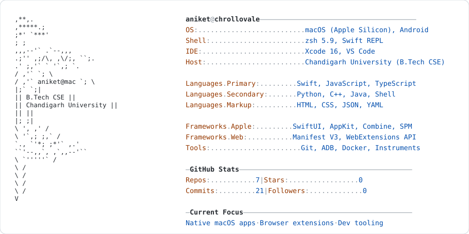

<a href="https://github.com/chrollovale">
  <picture>
    <source media="(prefers-color-scheme: dark)" srcset="https://raw.githubusercontent.com/chrollovale/chrollovale/main/dark_mode.svg">
    
  </picture>
</a>

---

## Projects

### macOS Applications

| Project | Description | Stack |
|---|---|---|
| **[Shift](https://github.com/chrollovale/Shift)** | High-speed bidirectional Android file transfer app for Mac with retro Platinum aesthetics. | `macOS 13+` `Swift` `SwiftUI` `ADB` |
| **[SlopMonster for macOS](https://github.com/chrollovale/SlopMonsterMac)** | Native desktop app and menu-bar tool to detect and eliminate AI tells and hollow prose. | `macOS 14+` `Swift 6` `NaturalLanguage` |
| **[KeyInjector](https://github.com/chrollovale/KeyInjector)** | Character-by-character keystroke and code injector with countdown audio cues. | `macOS 14+` `Swift` `Accessibility API` |

### Browser Extensions

| Project | Description | Platform |
|---|---|---|
| **[Master IDE Copier](https://github.com/chrollovale/Master-IDE-Copier)** | Universal suite to bypass clipboard restrictions and perform clean paste in online IDEs. | `Chromium` `Firefox` `Manifest V3` |
| **[WTF Coursera](https://github.com/chrollovale/WTF-Coursera)** | Automated course progress sweep, lesson fast-forwarding, and AI quiz solving. | `Chrome` `Brave` `Edge` |
| **[WTF LinkedIn Learning](https://github.com/chrollovale/WTF-LinkedIn-Learning)** | Video tracking automation and dialog dismissal for seamless course progression. | `Chromium Browsers` |
